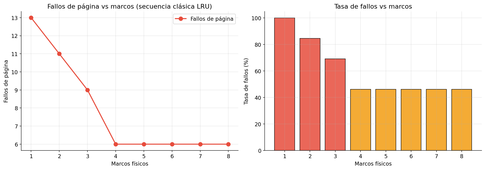
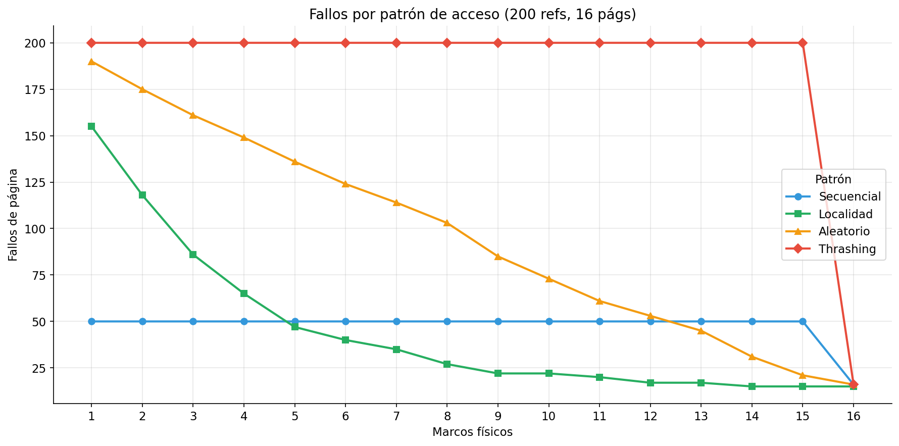
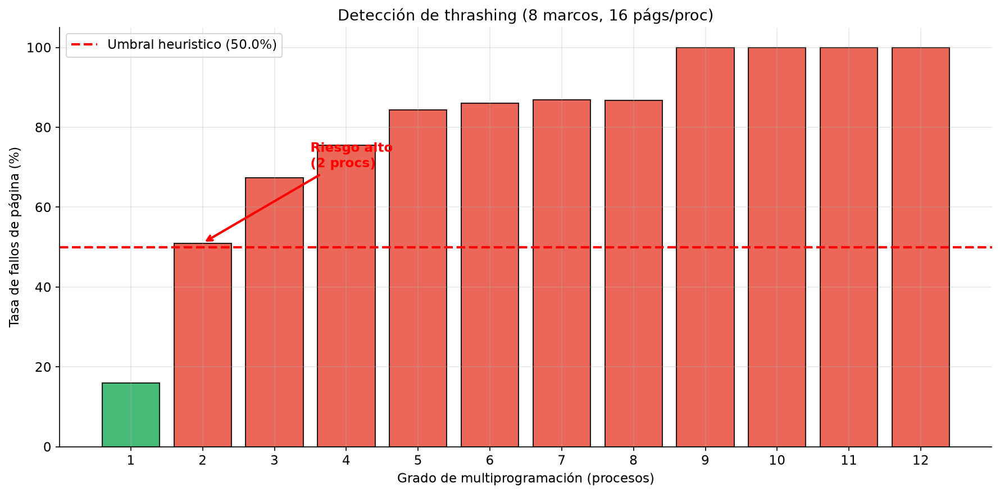
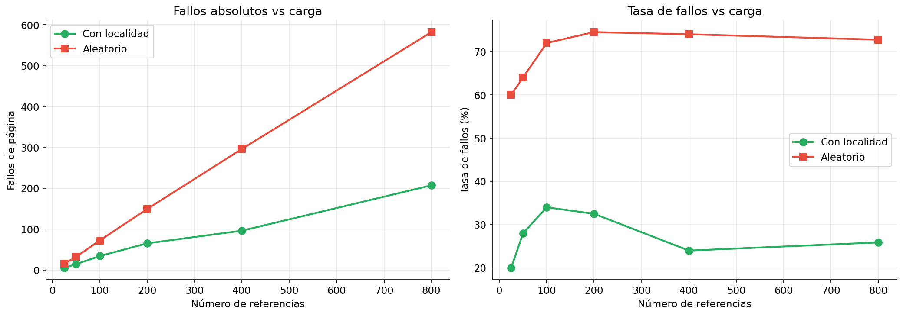
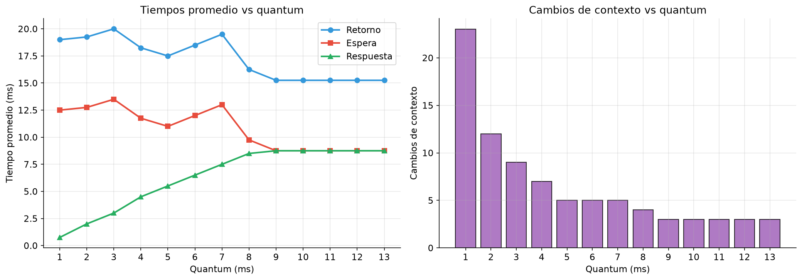
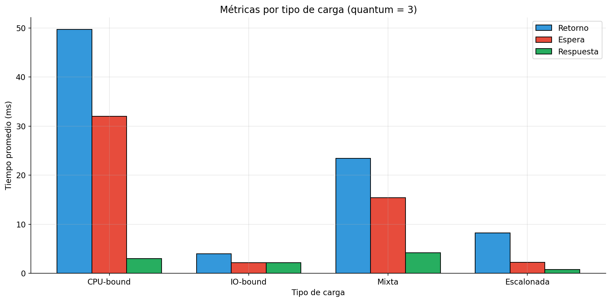
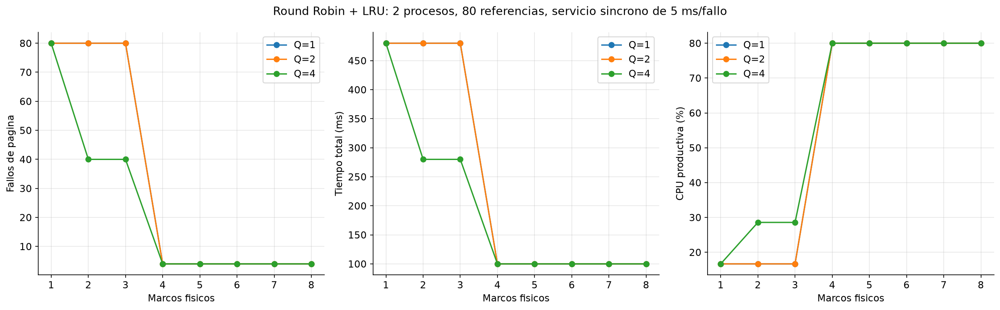
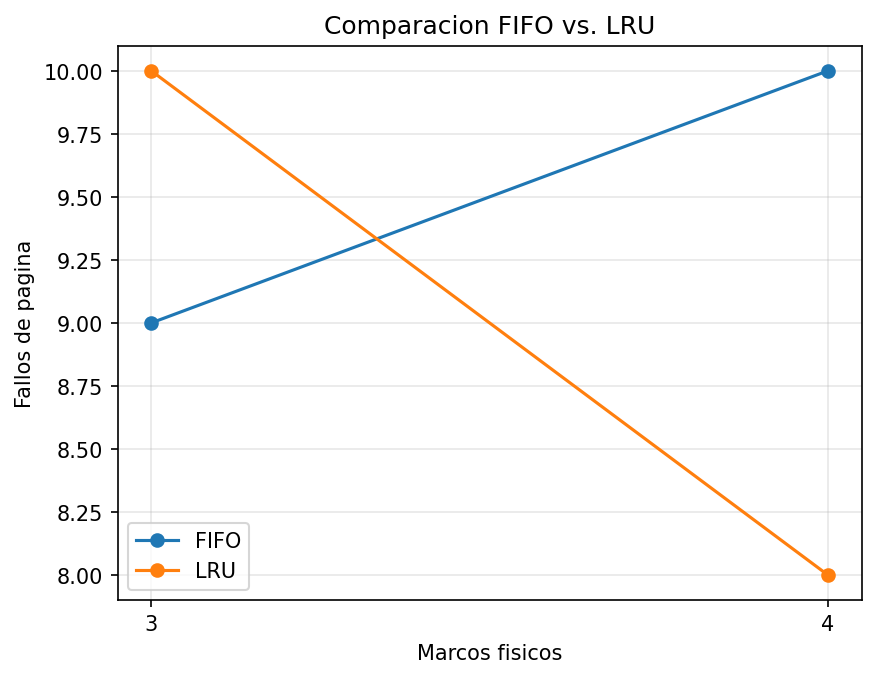
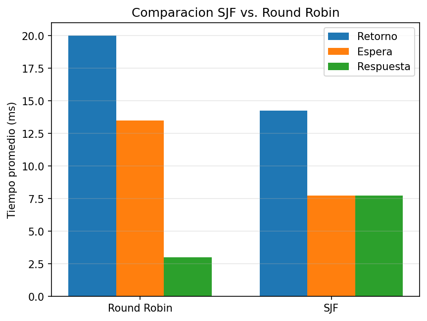

# Informe técnico: Entrega 3, CoreOS-IF0702

## 1. Objetivo y relación con la rúbrica

Se implementa un motor de planificación Round Robin acoplado a memoria virtual
paginada con reemplazo LRU global. Se registran traducciones, fallos, víctimas,
conmutaciones, tiempos por proceso y resultados comparativos de paginación.

| Criterio                         | Implementación                              | Evidencia reproducible            |
| -------------------------------- | -------------------------------------------- | --------------------------------- |
| Memoria virtual (8 puntos)       | Tablas por PID, traducción y LRU            | `make test-memoria`             |
| Planificador (6 puntos)          | Quantum, cola, Gantt y métricas             | `make test-planificador`        |
| Métricas y análisis (4 puntos) | Siete experimentos, incluyendo CPU + memoria | `make analisis`                 |
| Informe técnico (2 puntos)      | Modelo, fórmulas, módulos y límites       | Este informe y guías de módulos |
| Extras                           | Comparación FIFO/LRU y SJF/Round Robin      | `make test-extras-manuales`     |

El proyecto es un simulador de una CPU con tiempo discreto. No ejecuta procesos
reales para las ráfagas simuladas; el shell POSIX de entregas anteriores sigue
siendo un ejecutable separado y puede lanzar los simuladores como comandos.

## 2. Arquitectura modular

```text
main_memoria.c ----> memoria.c <---- main_integrada.c ----> planificador.c <---- main_planificador.c
                        ^                  |
                        |                  +-- configura callback por tick
                        +--------------------- acceso desde el proceso despachado

analisis/generar_analisis.py --> ejecutables C --> CSV + PNG + metadata.json
```

- `include/memoria.h`, `src/memoria.c`: tablas por proceso, marcos, traducción y LRU.
- `src/main_memoria.c`: interfaz de referencias y traza CSV independiente.
- `include/planificador.h`, `src/planificador.c`: PCB, cola y reloj de Round Robin.
- `src/main_planificador.c`: procesos configurables y demostración independiente.
- `src/main_integrada.c`: cargas por proceso, callback, coste de fallo y resumen.
- `analisis/generar_analisis.py`: cargas reproducibles y ejecución de experimentos.
- `tests/`: validadores de algoritmos, integración y errores del análisis.

Las guías [de memoria](memoria_virtual.md), [de planificación](planificador_round_robin.md)
y [de integración](integracion_cpu_memoria.md) contienen contratos y ejemplos.

## 3. Algoritmos y documentación matemática

### 3.1 Paginación y LRU

Cada PID tiene una tabla con presencia y marco. La memoria física es compartida;
cada marco registra PID, página y contador lógico del último acceso.

```text
pagina = direccion_virtual / tamaño_pagina        (división entera)
desplazamiento = direccion_virtual % tamaño_pagina
direccion_fisica = marco * tamaño_pagina + desplazamiento
```

Si la página no está presente se registra un fallo. Se elige primero el marco
libre de menor índice; si no hay, se reemplaza el de menor `ultimo_acceso`.
Se invalida la tabla de la víctima antes de registrar la nueva página. Tanto
aciertos como fallos actualizan la recencia. La identidad es `(PID, página)`:
la página 0 de dos procesos no es la misma página.

Un acierto consulta la tabla en O(1). Un fallo busca un marco en O(M), con M
marcos; el espacio es O(N*P + M), con N procesos y P páginas virtuales por proceso.
Las páginas comienzan ausentes y los fallos iniciales cuentan.

### 3.2 Round Robin

Una lista auxiliar ordena llegadas por tiempo y, en empates, por orden original.
La cola FIFO circular contiene como máximo N procesos. Cada turno consume
`min(quantum, restante)` unidades productivas. Las llegadas durante el turno,
incluida su frontera final, se encolan antes de reencolar al interrumpido.
Si no hay procesos listos, se registra IDLE hasta la siguiente llegada.

Estados: NUEVO -> LISTO -> EJECUTANDO -> LISTO o TERMINADO. En el modelo
integrado, un fallo con coste positivo pasa temporalmente por BLOQUEADO.
Se cuenta un despacho por turno y un cambio entre despachos consecutivos de PID
distinto, incluso si hay un intervalo IDLE. El primer despacho y repetir el
mismo PID no incrementan cambios. No se añade coste temporal por conmutación.

### 3.3 Acoplamiento temporal

Cada unidad productiva llama al módulo de memoria antes de avanzar el reloj.
El callback devuelve 0 para acceso sin demora o el coste `C` si hubo fallo.
Un valor negativo aborta con error. Durante el servicio síncrono la CPU completa
espera, sin consumir quantum; después se ejecuta la unidad productiva.
Se comprueban los límites del reloj entero para evitar desbordamientos.

La memoria se carga antes de avanzar el reloj del servicio y no hay accesos
concurrentes durante ese intervalo. Los marcos de procesos terminados se retienen
hasta finalizar. Este modelo no contiene E/S asíncrona, TLB, contenido de páginas,
páginas sucias ni disco real. Con coste cero reproduce el modelo sin latencia.

### 3.4 Métricas

| Métrica                 | Fórmula                                      |
| ------------------------ | --------------------------------------------- |
| Tasa de fallos           | `100 * fallos / referencias`                |
| Aciertos                 | `referencias - fallos`                      |
| Respuesta                | `primer_despacho - llegada`                 |
| Retorno                  | `fin - llegada`                             |
| Bloqueo propio           | `fallos_proceso * C`                        |
| Espera en cola           | `retorno - rafaga_CPU - bloqueo_propio`     |
| Promedio                 | `suma(metrica) / N`                         |
| Servicio de fallos       | `suma(bloqueos_propios)`                    |
| Tiempo total desde t=0   | `CPU_productiva + servicio_fallos + ocioso` |
| Utilización productiva  | `100 * CPU_productiva / tiempo_total`       |
| Fracción de paginación | `100 * servicio_fallos / tiempo_total`      |
| Rendimiento              | `referencias / tiempo_total`                |

La respuesta termina en el primer despacho, antes de servir su primer fallo.
El Gantt incluye CPU y servicio dentro del turno; las demoras se identifican
por acceso en la traza. En los módulos sin servicio, bloqueo=0 y se recupera
la fórmula original de espera.

## 4. Diseño experimental

Los experimentos 1 a 6 estudian los módulos independientes. El 7 ejecuta el
motor integrado. Se usan las mismas cargas al comparar configuraciones y semillas
fijas para patrones aleatorios. El experimento 7 es factorial: cruza quantum,
marcos y coste, comparando resultados con los otros parámetros fijos.

| Exp. | Configuración                                                   | Variable                                 |
| ---- | ---------------------------------------------------------------- | ---------------------------------------- |
| 1    | 13 referencias clásicas, páginas de 256 bytes                  | Marcos 1..8                              |
| 2    | 200 referencias, 16 páginas                                     | Patrón y marcos 1..16                   |
| 3    | 8 marcos, 50 referencias/PID, 8 páginas activas de 16 virtuales | 1..12 procesos                           |
| 4    | 4 marcos, 16 páginas                                            | Longitud 25..800, localidad/aleatorio    |
| 5    | P1(0,8), P2(1,4), P3(2,9), P4(3,5)                               | Quantum 1..13                            |
| 6    | Quantum 3; ráfagas largas, cortas, mixtas o escalonadas         | Tipo de carga                            |
| 7    | 2 procesos en t=0, 40 ticks/PID, referencias cíclicas 0/256     | Marcos 1..8, quantum 1/2/4, coste 0/5 ms |

En el experimento 3 cada PID usa `Random(2026 + PID)`. Su carga se conserva al
añadir procesos; se intercalan sus referencias por turno. Esto controla la
comparación entre grados de multiprogramación. Los otros patrones aleatorios
utilizan semilla 42. Las ráfagas cortas del experimento 6 representan trabajos
CPU cortos; no son una simulación de dispositivos de E/S.

## 5. Resultados y análisis

### 5.1 Fallos frente a marcos



La secuencia `7,0,1,2,0,3,0,4,2,3,0,3,2` contiene **seis páginas distintas**.
Con 1 marco hay 13 fallos, con 3 hay 9 y con 4 o más hay 6. Cuatro marcos bastan
para esta traza porque algunas páginas dejan de usarse antes de cargar las
últimas. Los seis fallos iniciales permanecen aun con memoria suficiente.
La curva observada no aumenta al añadir marcos.

### 5.2 Patrones de acceso



El patrón secuencial hace cuatro accesos por página: produce 50 fallos con 1..15
marcos y 16 con 16 marcos. La localidad concentra el 80% de las elecciones en
un conjunto de 3 páginas, y el resto en las 16 páginas. Con 4 marcos produce 65
fallos frente a 149 del aleatorio. No es una garantía de que siempre supere al
secuencial: son patrones distintos. El patrón cíclico adverso causa 200 fallos
con menos de 16 marcos y 16 fallos iniciales con 16 marcos.

### 5.3 Multiprogramación



Con un proceso se registran 8 fallos de 50 referencias (16%). Con dos hay 51
fallos de 100 (51%) y se cruza el umbral heurístico del proyecto. Desde nueve
procesos, una ronda requiere más páginas distintas de las que caben en ocho
marcos y esta carga alcanza 100% de fallos. Las fluctuaciones entre puntos
intermedios corresponden a las cargas reproducibles; la curva no es estrictamente
creciente. Este experimento mide frecuencia de fallos; no mide tiempos de CPU.

### 5.4 Longitud de carga



Con cuatro marcos y 800 referencias, localidad produce 207 fallos (25.875%) y
aleatorio 582 (72.75%). La tasa fluctúa por el patrón y por el arranque; la
cantidad de referencias por sí sola no obliga a una tasa monótona. La comparación
mantiene cuatro marcos fijos y no demuestra un efecto de variar marcos.

### 5.5 Quantum



Con quantum 3, los promedios son retorno 20 ms, espera 13.5 ms y respuesta 3 ms;
hay 10 despachos y 9 cambios de contexto. Quantum 1 reduce la respuesta promedio
a 0.75 ms y aumenta los cambios a 23. Con quantum >=9 hay tres cambios y respuesta
8.75 ms. Se mide la cantidad de cambios, no su coste temporal: no se puede
concluir una pérdida de rendimiento por overhead que el modelo no simula.

### 5.6 Tipos de ráfaga



La carga de ráfagas largas tiene retorno medio 49.67 ms; la de ráfagas cortas,
4 ms. La escalonada tiene retorno 8.25 ms y espera 2.25 ms. Estos resultados
comparan cargas con distintas longitudes y llegadas, y no prueban optimalidad
universal de Round Robin. Las llegadas escalonadas todavía se solapan.

### 5.7 Efecto conjunto de CPU y memoria



Resultados con quantum 1 y 80 referencias:

| Marcos | Coste/fallo | Fallos | Servicio |  Total | CPU productiva |
| -----: | ----------: | -----: | -------: | -----: | -------------: |
|      2 |        0 ms |     80 |     0 ms |  80 ms |           100% |
|      4 |        0 ms |      4 |     0 ms |  80 ms |           100% |
|      2 |        5 ms |     80 |   400 ms | 480 ms |         16.67% |
|      4 |        5 ms |      4 |    20 ms | 100 ms |            80% |

Con coste positivo y dos marcos, la paginación ocupa 83.33% del tiempo. Con cuatro
marcos ocupa 20%. Manteniendo dos marcos y coste 5, elevar quantum a 4 permite
reutilizar páginas dentro de cada turno: los fallos bajan a 40 y el total a 280 ms.
La evidencia muestra tanto el efecto del orden de CPU en LRU como el efecto de
los fallos en los tiempos. La mejora depende de esta carga y del modelo síncrono.

## 6. Extras: comparación de algoritmos

Como ampliación independiente de la entrega se implementaron dos comparaciones
reproducibles. Estos programas reutilizan las estructuras y reglas de los
módulos principales, pero no modifican el comportamiento de LRU, Round Robin ni
del ejecutable integrado.

### 6.1 FIFO frente a LRU

Se compararon ambas políticas con la misma secuencia de páginas:

```text
1 2 3 4 1 2 5 1 2 3 4 5
```

Cada política se ejecuta en una instancia nueva de memoria, con páginas de 256
bytes. FIFO usa el instante de carga como orden de reemplazo y no actualiza la
posición de una página cuando ocurre un acierto. LRU, en cambio, actualiza la
recencia tanto en aciertos como en fallos.

| Política |  3 marcos |  4 marcos |
| --------- | --------: | --------: |
| FIFO      |  9 fallos | 10 fallos |
| LRU       | 10 fallos |  8 fallos |

El resultado muestra la anomalía de Bélády en FIFO: al aumentar de tres a cuatro
marcos, los fallos suben de 9 a 10. En esta carga LRU no presenta ese aumento y
mejora de 10 a 8 fallos. Esto no significa que LRU siempre sea mejor para toda
secuencia, sino que las políticas responden de forma diferente al patrón de
acceso.



La gráfica confirma visualmente que FIFO empeora en la configuración de cuatro
marcos, mientras LRU reduce los fallos. Los datos usados para construirla se
conservan en [extra_fifo_lru.csv](graficos/extra_fifo_lru.csv).

Se reproduce con:

```sh
make extra_memoria
./extra_memoria
```

### 6.2 SJF no apropiativo frente a Round Robin

Se comparó SJF no apropiativo con Round Robin usando los cuatro procesos de la
carga principal y quantum 3. SJF elige, entre los procesos ya llegados, la
ráfaga más corta y ejecuta esa ráfaga hasta terminar. En empates se conserva el
orden de llegada y después la posición original. No se implementa SRTF.

| Algoritmo   | Retorno promedio | Espera promedio | Respuesta promedio |
| ----------- | ---------------: | --------------: | -----------------: |
| Round Robin |         20.00 ms |        13.50 ms |            3.00 ms |
| SJF         |         14.25 ms |         7.75 ms |            7.75 ms |

En esta carga, SJF reduce el retorno y la espera promedio, mientras Round Robin
ofrece una respuesta promedio menor. Es el compromiso esperado: SJF favorece la
finalización de trabajos cortos, mientras Round Robin reparte la CPU y favorece
la interacción. Los valores no prueban que un algoritmo sea universalmente
superior.



La gráfica muestra que SJF obtiene menores tiempos promedio de retorno y espera,
mientras Round Robin obtiene menor tiempo de respuesta. Los datos que alimentan
la comparación están disponibles en [extra_sjf_rr.csv](graficos/extra_sjf_rr.csv).

Se reproduce con:

```sh
make extra_cpu
./extra_cpu
```

Los resultados también se pueden visualizar automáticamente:

```sh
make graficos-extras
```

Este comando genera `docs/graficos/extra_fifo_lru.png`,
`docs/graficos/extra_sjf_rr.png` y sus tablas CSV correspondientes. El primer
gráfico muestra los fallos según el número de marcos; el segundo compara las
tres métricas promedio de CPU.

### 6.3 Validación y límites de los extras

Las comparaciones se prueban sin mezclar instancias FIFO y LRU. También se
validan traducciones, víctimas, límites, reinicios, llegadas, empates y el
callback síncrono del planificador:

```sh
make test-extras-manuales
```

Los extras de CPU se ejecutan de forma independiente y no añaden costes de
memoria ni de conmutación a la comparación SJF/Round Robin. La comparación
FIFO/LRU tampoco sustituye al simulador integrado: su objetivo es aislar el
efecto de la política de reemplazo sobre una misma secuencia.

## 7. Interpretación de thrashing

El proyecto usa la tasa de fallos como **indicador heurístico**: <30% NORMAL,
30%..50% ADVERTENCIA y >50% RIESGO ALTO. Los límites se comparan con los conteos,
sin redondear el porcentaje para decidir. El 50% es una elección experimental
del equipo, no una definición universal ni una consecuencia automática del
modelo de working set.

Una tasa alta puede contener muchos fallos iniciales. Para evaluar su efecto se
consideran también servicio de fallos, fracción de paginación, rendimiento y
localidad. El experimento 7 exhibe degradación sostenida en una carga cíclica
con memoria insuficiente y coste positivo. Con coste cero puede haber 100% de
fallos sin pérdida temporal, lo que explica por qué no basta la tasa aislada.

La condición de presión de memoria puede expresarse como
`sum(|WS_i(t, ventana)|) > marcos`, donde WS es el conjunto de páginas distintas
usadas en una ventana. Este proyecto no calcula working sets por ventana ni
implementa control de admisión o asignación local. Esas son extensiones posibles,
no funcionalidades demostradas por estos resultados.

## 8. Validación y errores

`make test-memoria` revisa traducciones, aislamiento por PID, víctimas LRU,
límites e invariantes tras 10 000 accesos; compara además 15 escenarios de 150
referencias con un modelo independiente.

`make test-planificador` revisa estados, reinicio, 10 001 turnos, 151 procesos,
7 casos dirigidos y 80 aleatorios. También valida callback con servicio, error,
reinicio de bloqueos y desbordamiento de reloj.

`make test-integrada` contrasta todas las columnas CSV, Gantt, métricas y tiempos
con un modelo independiente: 7 casos dirigidos y 80 aleatorios. Sus 27 casos
inválidos incluyen listas mal formadas, referencias fuera de rango, errores de
traza y límites numéricos. Toda simulación fallida devuelve código distinto de cero.

`make test-analisis` verifica umbrales, rechazo de salidas incompatibles y errores
de los ejecutables, cargas por PID y separación entre resultados reales y demo.
La suite completa también mantiene las verificaciones de entregas anteriores.
El estrés conserva 20 repeticiones de 10 000 datos y una cota de 60 s por ejecución,
configurable con `LIMIT`: con la traza completa, esta máquina WSL puede superar
la cota anterior de 15 s aun avanzando correctamente. El límite no sustituye la
verificación de cuotas, identidad de datos y ausencia de pérdidas/duplicados.

## 9. Conclusiones y límites

La implementación conserva el estado por proceso, aplica LRU correctamente y
calcula las métricas de Round Robin. El acoplamiento permite que la planificación
modifique la secuencia de referencias y que un fallo con coste aumente la duración.

Los gráficos documentan cargas concretas; no prueban que un quantum, algoritmo
o umbral sea óptimo en todos los sistemas. El servicio es síncrono y serializado:
no se representa un SO que solape trabajo de otros procesos con E/S de disco.
No se implementan contenidos de memoria ni políticas de admisión. Las métricas
se interpretan dentro de esos supuestos explícitos.

## 10. Reproducibilidad

```sh
python3 -m venv .venv
.venv/bin/python -m pip install -r requirements.txt
make all
make test
make integrada
make analisis
```

Ubuntu necesita `python3-venv` para crear el entorno. El Makefile selecciona el
Python local automáticamente. La ejecución real requiere los tres binarios C y
matplotlib; un error de ejecución o de formato detiene el análisis en lugar de
convertirse en cero fallos. `--solo-tablas` permite omitir gráficos explícitamente.

El resultado real contiene siete PNG, ocho CSV y `metadata.json` con modo,
fecha, versiones, semillas y hashes de ejecutables. Seis experimentos de ejemplo
Python pueden ejecutarse con `--demo`; sus archivos se guardan por separado en
`docs/graficos/demo/` y no se usan como evidencia de los ejecutables C.

## 11. Referencias de estudio

- Tanenbaum, A. S. y Bos, H. *Modern Operating Systems*, 4.ª ed., capítulos 2 y 3.
- Silberschatz, Galvin y Gagne. *Operating System Concepts*, 10.ª ed., planificación y memoria virtual.
- Denning, P. J. (1968). *The Working Set Model for Program Behavior*.
  Communications of the ACM, 11(5), 323-333.

Las definiciones operacionales del simulador y los parámetros experimentales
están especificados en este informe; las referencias proporcionan contexto de estudio.
